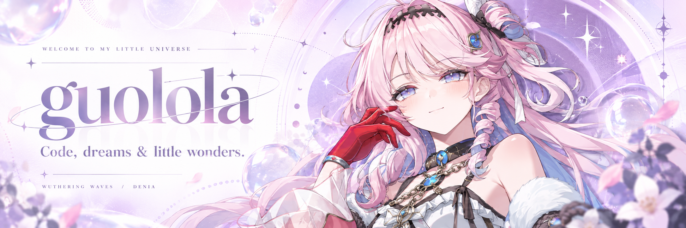

  

   
   

  **白天把想法写成代码，闲暇时去索拉里斯漫游。**

  AI 辅助软件工程 · UML 建模 · 前端原型 · 鸣潮 / 达妮娅推

  

    
    
    
  

  ✧ Code, dreams &amp; little wonders. ✧

 

## ✧ 关于我 · About me

Hi，我是 **guolola**。喜欢把模糊的想法，慢慢变成看得见、讲得清、跑得起来的东西。

- **正在做**：面向软件工程教学的 AI 辅助实验平台。
- **关注方向**：需求分析、UML 建模，以及从模型到前端原型的完整链路。
- **日常工具**：JavaScript、Vue、HTML / CSS、Node.js。
- **代码之外**：喜欢二次元，也喜欢《鸣潮》里的达妮娅。给代码留一点认真，也给喜欢的角色留一个位置。

## ✧ 技能背包 · My toolkit

  

   
   

  
  
  
  

 

## ✧ 作品陈列室 · Selected works

### 01 / [UML 实验平台](https://github.com/guolola/uml-experimental-platform)

从需求、UML / PlantUML 到原型与文档，让软件工程实验拥有一条清晰、可追溯的路径。

 

### 02 / [组件集在线演示](https://github.com/guolola/guolola-element-componentset)

把组件放进真实页面里，直观展示界面、交互和使用方式。

 

### 03 / [井工程数据中心](https://github.com/guolola/Well-engineering-data-center)

面向井工程场景的数据中心原型，把业务信息组织成可浏览的界面。

 

 

<a href="https://github.com/guolola?tab=repositories">查看全部仓库 ↗</a>

## ✧ 每日足迹 · Little by little

让每一次小小的提交，连成自己的星轨。

  <picture>
    <source media="(prefers-color-scheme: dark)" srcset="https://raw.githubusercontent.com/guolola/guolola/output/github-contribution-grid-snake-dark.svg" />
    <source media="(prefers-color-scheme: light)" srcset="https://raw.githubusercontent.com/guolola/guolola/output/github-contribution-grid-snake.svg" />
    
  </picture>

 

  
✧ 我的构建习惯 · Behind the scenes

   

  **先建模** — 把模糊需求变成明确、可检查的结构。

  **保持可追溯** — 让需求、模型、原型之间的关系始终可见。

  **尽早跑起来** — 用实际界面验证想法，再逐步完善。

 

  

  达妮娅主题 · 非官方粉丝主页 · 角色属于《鸣潮》/ KURO GAMES
   
  横幅为 AI 辅助创作，参考 <a href="https://www.kurobbs.com/mc/post/1505257912809955328?enter_source=2">库街区公开角色宣传图</a>。

