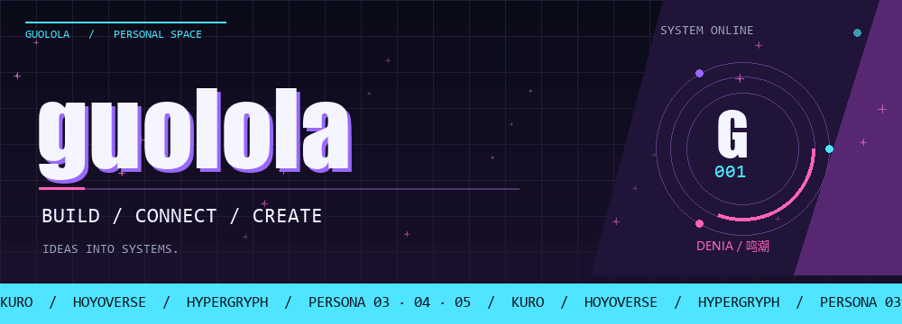
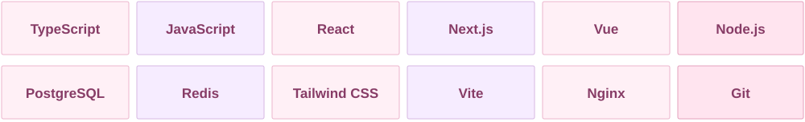
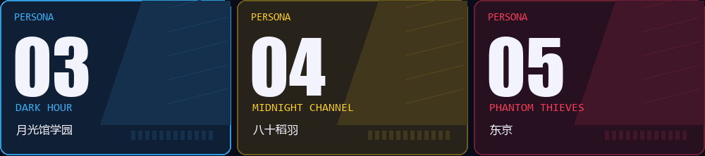
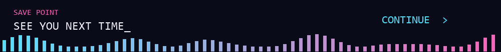

<picture>
  <source media="(prefers-reduced-motion: reduce)" srcset="./assets/profile-hero-still.png" />
  
</picture>

 

## 01 / 关于我

<picture>
  <source media="(prefers-reduced-motion: reduce)" srcset="./assets/daniya-still.png" />
  
</picture>

Hi，我是 **guolola**。

关注 AI 辅助的软件工程、服务端系统与可视化工具。

目前主要维护 **[SoftJL](https://github.com/guolola/SoftJL)**： 
围绕需求、UML、系统设计、测试和工程文档， 
构建可追溯的工程实践工作台。

`TypeScript` `Node.js` `React` `PostgreSQL`

[在线体验](https://jianglisoftware.com) · [使用手册](https://jianglisoftware.com/tutorial)

 

## 02 / 技术栈

  

| 方向 | 项目中使用的技术 |
| :-- | :-- |
| **语言** | TypeScript · JavaScript · SQL · HTML · CSS |
| **界面与可视化** | React · Next.js · Vue · Tailwind CSS · ECharts · React Flow |
| **服务端** | Node.js · Fastify · Zod |
| **数据与任务** | PostgreSQL · Redis · BullMQ |
| **AI 与集成** | OpenAI SDK · MCP · PlantUML |
| **文档与渲染** | ONLYOFFICE · docx · PDFKit |
| **测试与部署** | Vitest · Playwright · Nginx · PM2 · GitHub Actions |

依据公开仓库中的依赖清单、实现与部署配置整理：<a href="./assets/STACK-SOURCES.md">查看依据</a>。

## 03 / 项目

### [SoftJL](https://github.com/guolola/SoftJL)

面向毕业设计与课程设计的工程实践工作台。关联需求、UML、系统设计、测试与文档，提供来源追踪与覆盖检查；包含 API、任务队列、文档服务及 MCP 接入。

`TypeScript` `React / Next.js` `Fastify` `PostgreSQL` `Redis`

### [井工程数据中心](https://github.com/guolola/Well-engineering-data-center)

面向井工程业务的数据展示与可视化界面。

`Vue` `TypeScript` `ECharts` `Vite`

### [组件集在线演示](https://github.com/guolola/guolola-element-componentset)

组件集的在线演示页面。

`HTML`

<a href="https://github.com/guolola?tab=repositories">全部仓库 →</a>

<picture>
  <source media="(prefers-reduced-motion: reduce)" srcset="./assets/persona-select-still.png" />
  
</picture>

## 04 / 贡献记录

<picture>
  <source media="(prefers-color-scheme: dark)" srcset="https://raw.githubusercontent.com/guolola/guolola/output/github-contribution-grid-snake-dark.svg" />
  <source media="(prefers-color-scheme: light)" srcset="https://raw.githubusercontent.com/guolola/guolola/output/github-contribution-grid-snake.svg" />
  
</picture>

 

<picture>
  <source media="(prefers-reduced-motion: reduce)" srcset="./assets/save-point-still.png" />
  
</picture>

<a href="./assets/CREDITS.md">素材来源</a>

