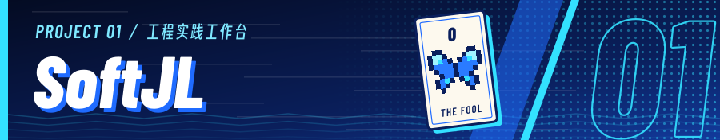
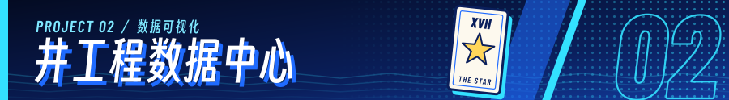
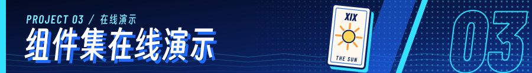

<picture>
  <source media="(prefers-reduced-motion: reduce)" srcset="./assets/hero-rooftop-still.png" />
  
</picture>

&nbsp;
&nbsp;

<h3><picture>
  <source media="(prefers-color-scheme: dark)" srcset="./assets/ui/section-about-dark.svg" />
  
</picture></h3>

<picture>
  <source media="(prefers-reduced-motion: reduce)" srcset="./assets/denia-portrait-still.png" />
  
</picture>

关注 **AI 辅助的软件工程**、**服务端系统**与**可视化工具**。

目前主要维护 **[SoftJL](https://github.com/guolola/SoftJL)**：围绕需求、UML、系统设计、测试和工程文档，构建可追溯的工程实践工作台。

[在线体验](https://jianglisoftware.com)　·　[使用手册](https://jianglisoftware.com/tutorial)

 

<h3><picture>
  <source media="(prefers-color-scheme: dark)" srcset="./assets/ui/section-stack-dark.svg" />
  
</picture></h3>

<b>AI 应用</b> 

<b>Agent 工程</b> 

<b>前端工程</b> 

<b>后端与数据</b> 

<b>工程工具</b> 

<a href="./assets/STACK-SOURCES.md">技术信息依据 ↗</a>

<h3><picture>
  <source media="(prefers-color-scheme: dark)" srcset="./assets/ui/section-projects-dark.svg" />
  
</picture></h3>

面向毕业设计与课程设计的工程实践工作台，关联需求、UML、系统设计、测试与文档，提供来源追踪与覆盖检查。 
工程模型　·　来源追踪　·　任务队列　·　文档服务

**[在线体验&nbsp;↗](https://jianglisoftware.com)**　·　**[使用手册&nbsp;↗](https://jianglisoftware.com/tutorial)**　·　**[源码仓库&nbsp;↗](https://github.com/guolola/SoftJL)**

 

面向井工程业务的数据展示与可视化界面。

**[源码仓库&nbsp;↗](https://github.com/guolola/Well-engineering-data-center)**

 

组件集的在线演示页面。

**[在线演示&nbsp;↗](https://guolola-element-componentset.vercel.app)**　·　**[源码仓库&nbsp;↗](https://github.com/guolola/guolola-element-componentset)**

<a href="https://github.com/guolola?tab=repositories">全部仓库 →</a>

<h3><picture>
  <source media="(prefers-color-scheme: dark)" srcset="./assets/ui/section-activity-dark.svg" />
  
</picture></h3>

<picture>
  <source media="(prefers-color-scheme: dark)" srcset="./assets/ui/activity-dark.svg" />
  
</picture>

贡献快照 · 2026-10-12

<a href="./assets/CREDITS.md">素材来源</a>

